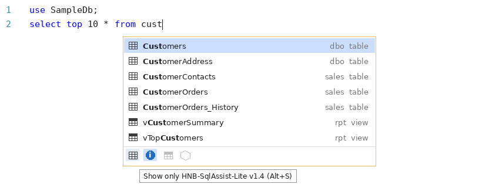
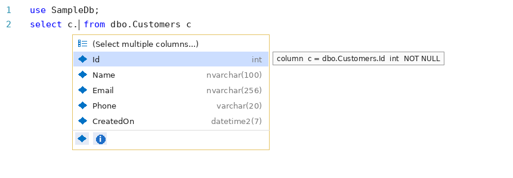
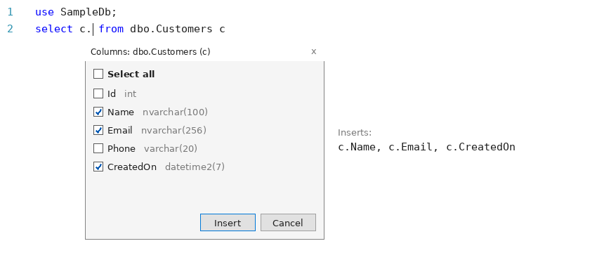
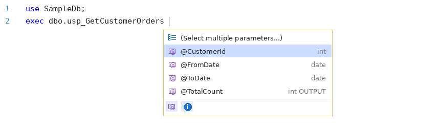
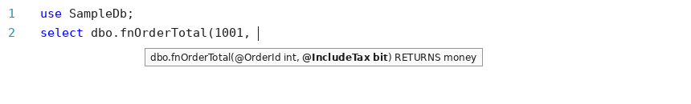
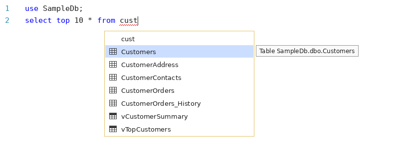

# HNB-SqlAssist-Lite

Code completion for **SQL Server Management Studio (SSMS) 21 and 22**.

As you write queries, HNB-SqlAssist-Lite suggests databases, tables, views, procedures, functions, **columns** and **parameters** from the server your query window is connected to. It understands table aliases, keeps columns in their table order, and lets you insert several columns or parameters at once with checkboxes.



---

## Contents

- [Features](#features)
- [Requirements](#requirements)
- [Download](#download)
- [Install](#install)
- [Set up SSMS](#set-up-ssms)
- [Using it](#using-it)
- [Keyboard shortcuts](#keyboard-shortcuts)
- [Updating](#updating)
- [Uninstall](#uninstall)
- [Troubleshooting](#troubleshooting)
- [Known limitations](#known-limitations)
- [Privacy and server access](#privacy-and-server-access)

---

## Features

| When you type | You get |
|---|---|
| `USE ` | Databases you can access |
| `FROM `, `JOIN `, `INSERT INTO `, `UPDATE `, `APPLY `, `FROM a, ` | Tables, views and table-valued functions |
| `dbo.` / `SalesDb.` / `SalesDb.dbo.` | Objects in that schema, or schemas in that database |
| `EXEC ` | Stored procedures |
| `SELECT `, `WHERE `, `AND `, `OR `, `ON `, `ORDER BY `, `GROUP BY `, `HAVING `, `SET ` | Columns of the tables in the statement |
| `c.` (an alias) or `Customers.` | Columns of that table |
| `INSERT INTO dbo.Customers (` | Columns of that table |
| `EXEC dbo.usp_GetCustomer ` | The procedure's parameters |
| `dbo.fnOrderTotal(` | A tooltip with the function's parameters and return type |

It also:

- **Understands aliases.** `FROM dbo.Customers c` makes `c.` list the columns of `Customers`, and an aliased table is always shown and inserted by its alias.
- **Keeps columns in table order,** the way they are defined in the table, not alphabetically.
- **Lets you insert several columns or parameters at once** from a checkbox list.
- **Follows `USE` statements:** after `USE SalesDb` you see objects from `SalesDb`.
- **Keeps each query separate.** Tables in one query do not show up in another query in the same window, even without `;` between them.
- **Stays quiet in comments and strings.** Nothing pops up inside `-- comments`, `/* blocks */` or `'text'`.
- Adds `schema.` and `[brackets]` where needed, for example `dbo.Customers` or `[Order Details]`.
- Matches anywhere in the name: typing `cust` finds `Customers`, `CustomerOrders` and `vTopCustomers`.

---

## Requirements

| Item | Supported |
|---|---|
| SSMS | 21.x or 22.x |
| Windows | 10 or 11, 64-bit |
| Login type | Windows Authentication or SQL Server login |

Microsoft Entra ID (Azure AD) and MFA connections are not supported yet. See [Known limitations](#known-limitations).

---

## Download

From the [Releases](../../releases) page, download these files from the latest release into one folder:

| File | Purpose |
|---|---|
| `HNB-SqlAssist-Lite.vsix` | The extension |
| `Install.cmd` | One-click installer |
| `Uninstall.cmd` | One-click uninstaller |

---

## Install

> **Do not double-click the `.vsix` file.** Windows opens it with the Visual Studio installer, which cannot install into SSMS.

### Option 1: Install.cmd (recommended)

1. Save your work in SSMS. The installer closes SSMS.
2. Double-click **`Install.cmd`**.
3. Click **Install** in the installer window, then **Close** when it finishes.

`Install.cmd` finds SSMS 22 first and falls back to SSMS 21.

### Option 2: PowerShell

Close SSMS, open PowerShell in the download folder, and run:

```powershell
& "C:\Program Files\Microsoft SQL Server Management Studio 21\Release\Common7\IDE\VSIXInstaller.exe" "$PWD\HNB-SqlAssist-Lite.vsix"
```

For SSMS 22, change `21` to `22`.

---

## Set up SSMS

HNB-SqlAssist-Lite replaces SSMS's built-in suggestion list, so turn the built-in one off. Otherwise the two lists compete.

1. Open SSMS.
2. Go to **Tools > Options > Text Editor > Transact-SQL > IntelliSense**.
3. Uncheck **Enable IntelliSense** and click **OK**.
4. Open a **new** query window. Windows that were already open keep the old behavior.

---

## Using it

### The basics

1. Connect to a server and open a query window.
2. Start typing. The list opens on its own after the keywords in the [Features](#features) table, and after a dot such as `dbo.` or `c.`.
3. Keep typing to narrow the list.
4. Press **Tab** or **Enter** to insert the selected item. Press **Esc** to close the list.
5. Press **Ctrl+Space** to open the list anywhere it makes sense, for example after `WHERE c.Id = `, where it does not open on its own so it never gets in the way of typing values.

### Columns and aliases



- After `c.`, you get the columns of the table aliased `c`, in table order, with each column's type on the right.
- The tooltip shows the full name, type and whether the column allows `NULL`.
- After `SELECT ` or `WHERE ` without an alias, you get the columns of every table in the query. If a column name exists in more than one table, it is inserted as `alias.column` so the query stays valid.

### Selecting several columns or parameters at once

The first row of a column or parameter list is **(Select multiple columns...)** or **(Select multiple parameters...)**. Pick it to open a checkbox list:



- Tick the ones you want, or use **Select all**.
- Click **Insert** or press **Enter**. Press **Esc** to cancel.
- Items are inserted in table or declaration order, the way you would type them yourself:

| Where you were | What gets inserted |
|---|---|
| After `c.` | `c.Name, c.Email, c.CreatedOn` |
| Inside `INSERT INTO dbo.Customers (` | `Name, Email, CreatedOn` |
| After `SELECT ` with several tables | `c.Name, o.OrderDate` |
| After `EXEC dbo.usp_GetCustomerOrders ` | `@CustomerId = , @FromDate = ` (the cursor waits after the first `= ` for your value) |

### Stored procedure parameters



After `EXEC dbo.ProcName ` you get the procedure's parameters in declaration order, with type and `OUTPUT` where it applies. Picking one inserts `@Name = `. After a comma, parameters you have already written are left out.

### Function parameters



Typing `(` after a scalar or table-valued function shows its parameters and return type. The parameter you are on is shown in bold and moves as you type commas. Press **Ctrl+Shift+Space** to show it again.

### Filter bar

The icons at the bottom of the list narrow it down. Click an icon or use its shortcut while the list is open. Grayed-out icons mean the current list has nothing of that type.

| Filter | Shortcut |
|---|---|
| Columns | Alt+O |
| Parameters | Alt+R |
| Tables | Alt+T |
| Views | Alt+V |
| Stored procedures | Alt+P |
| Functions | Alt+F |
| Databases | Alt+D |
| Schemas | Alt+C |
| HNB-SqlAssist-Lite (blue info icon) | Alt+S |

Hovering the blue info icon shows the installed version, for example *Show only HNB-SqlAssist-Lite v1.4 (Alt+S)*.

### New tables or columns not showing up?

Object, column and parameter lists for each database load the first time you need them and are reused for the rest of the SSMS session. The first list for a database can take a moment; after that it opens instantly. If you create, change or drop objects, **restart SSMS** to see the changes.

---

## Keyboard shortcuts

| Keys | Action |
|---|---|
| Ctrl+Space | Open the suggestion list |
| Ctrl+J | Open the suggestion list |
| Ctrl+Shift+Space | Show function parameters |
| Tab / Enter | Insert the selected item |
| Esc | Close the list |
| Alt+letter | Filter the list (see [Filter bar](#filter-bar)) |

---

## Updating

1. Download the new `HNB-SqlAssist-Lite.vsix` from [Releases](../../releases).
2. Run **`Install.cmd`** again. It upgrades the existing installation.

To check which version you have, hover the blue info icon in the filter bar.

---

## Uninstall

Double-click **`Uninstall.cmd`**, or close SSMS and run:

```powershell
& "C:\Program Files\Microsoft SQL Server Management Studio 21\Release\Common7\IDE\VSIXInstaller.exe" /uninstall:SqlAssistLite.31f1541f-73c8-46e1-b0eb-204cdd50bed5
```

For SSMS 22, change `21` to `22`. SSMS has no Extensions screen, so uninstalling is done this way. Afterwards you can turn built-in IntelliSense back on under **Tools > Options > Text Editor > Transact-SQL > IntelliSense**.

---

## Troubleshooting

### Is the list from HNB-SqlAssist-Lite or from SSMS?

This is SSMS's **built-in** IntelliSense:



You are looking at the built-in list if:

- the first row repeats what you typed
- there is no gray type column on the right
- there is no filter bar at the bottom
- the word you typed has a red squiggle underneath

If you see it, turn off built-in IntelliSense (see [Set up SSMS](#set-up-ssms)) and open a new query window.

### Common problems

| Problem | Try this |
|---|---|
| Installer says no compatible product found | Use `Install.cmd`, or the `VSIXInstaller.exe` inside the SSMS folder. Only SSMS 21 and 22 are supported. |
| `Install.cmd` says SSMS was not found | SSMS is installed in a non-default folder. Use the PowerShell option with your SSMS path. |
| No suggestions at all | Open a new query window. If that does not help, restart SSMS, then check the log (below). |
| No suggestions on one server | Check the login type. Microsoft Entra ID and MFA connections are not supported. |
| No columns after an alias | Make sure the alias is defined in the same query (`FROM dbo.Customers c`). Columns of CTEs, subqueries and temp tables are not supported yet. |
| Ctrl+Space does nothing | Open a new query window. Also check **Tools > Options > Environment > Keyboard** that `Edit.CompleteWord` is still mapped to Ctrl+Space. |
| First list for a database is slow | Normal. The lists are loading. Later lists are instant. |
| A new table or column is missing | Restart SSMS to reload the lists. |
| Still not working | Open an [issue](../../issues) and attach the log file `%TEMP%\HNB-SqlAssist-Lite.log`. |

To open the log, press **Win+R**, paste `%TEMP%\HNB-SqlAssist-Lite.log` and press **Enter**.

---

## Known limitations

- Microsoft Entra ID (Azure AD) and MFA connections get no suggestions.
- No columns for CTEs, subqueries in `FROM (SELECT ...) x`, temp tables (`#t`) or table variables (`@t`).
- No parameter tooltip for built-in functions such as `DATEADD` or `CONVERT`. Your own functions are covered.
- New, changed or dropped objects show up after restarting SSMS.
- SSMS does not officially support extensions, so a future SSMS update could stop it working until a new version is released.

---

## Privacy and server access

- HNB-SqlAssist-Lite only reads **names and definitions** from system views (`sys.databases`, `sys.objects`, `sys.schemas`, `sys.columns`, `sys.parameters`, `sys.types`). It never reads data from your tables.
- It connects with the same server and login as your query window, on its own separate connection, and shows up as **HNB-SqlAssist-Lite** in `sp_who2` and Activity Monitor.
- Connections are encrypted. If a server reports that it cannot encrypt, the extension falls back to an unencrypted connection for that server, the same way SSMS's own query window does.
- Nothing is sent anywhere outside your SQL Server. The only file it writes is the log in your `%TEMP%` folder.
