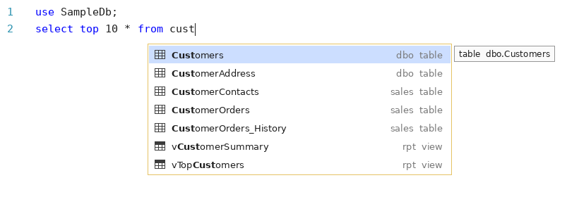

# HNB-SqlAssist-Lite

Code completion for **SQL Server Management Studio (SSMS) 21 and 22**.

As you write queries, HNB-SqlAssist-Lite suggests databases, schemas, tables, views, stored procedures and functions from the server your query window is connected to.


---

## Contents

- [What it does](#what-it-does)
- [Requirements](#requirements)
- [Download](#download)
- [Install](#install)
- [Set up SSMS](#set-up-ssms)
- [Using it](#using-it)
- [Updating](#updating)
- [Uninstall](#uninstall)
- [Troubleshooting](#troubleshooting)
- [Known limitations](#known-limitations)
- [Privacy and server access](#privacy-and-server-access)

---

## What it does

| When you type | You get |
|---|---|
| `USE ` | Databases you can access |
| `FROM `, `JOIN `, `INSERT INTO `, `UPDATE `, `APPLY ` | Tables, views and table-valued functions |
| `EXEC ` / `EXECUTE ` | Stored procedures |
| `dbo.` | Objects in the `dbo` schema |
| `SalesDb.` | Schemas in the `SalesDb` database |
| `SalesDb.dbo.` | Objects in `SalesDb.dbo` |

It also:

- follows `USE` statements, so after `USE SalesDb` you see objects from `SalesDb`
- inserts `schema.name` when you pick an object, for example `dbo.Customers`
- adds brackets to names that need them, for example `[Order Details]`
- matches anywhere in the name, so typing `cust` finds `Customers`, `CustomerOrders` and `vTopCustomers`

---

## Requirements

| Item | Supported |
|---|---|
| SSMS | 21.x or 22.x |
| Windows | 10 or 11, 64-bit |
| Login type | Windows Authentication or SQL Server login |

Microsoft Entra ID (Azure AD) and MFA connections are not supported yet. See [Known limitations](#known-limitations).

---

## Download

Go to the [Releases](../../releases) page and download these files from the latest release into one folder:

| File | Purpose |
|---|---|
| `HNB-SqlAssist-Lite.vsix` | The extension |
| `Install.cmd` | One-click installer |
| `Uninstall.cmd` | One-click uninstaller |

---

## Install

> **Do not double-click the `.vsix` file.** Windows opens it with the Visual Studio installer, which cannot install into SSMS.

### Option 1: Install.cmd (recommended)

1. Save your work in SSMS. The installer closes SSMS.
2. Double-click **`Install.cmd`**.
3. Click **Install** in the installer window, then **Close** when it finishes.

`Install.cmd` finds SSMS 22 first and falls back to SSMS 21.

### Option 2: PowerShell

Close SSMS, open PowerShell in the download folder, and run:

```powershell
& "C:\Program Files\Microsoft SQL Server Management Studio 21\Release\Common7\IDE\VSIXInstaller.exe" "$PWD\HNB-SqlAssist-Lite.vsix"
```

For SSMS 22, change `21` to `22`.

---

## Set up SSMS

HNB-SqlAssist-Lite replaces SSMS's built-in suggestion list, so turn the built-in one off. Otherwise the two lists compete.

1. Open SSMS.
2. Go to **Tools > Options > Text Editor > Transact-SQL > IntelliSense**.
3. Uncheck **Enable IntelliSense** and click **OK**.
4. Open a **new** query window. Windows that were already open keep the old behavior.

---

## Using it

1. Connect to a server and open a query window.
2. Start typing. The list opens on its own after `USE `, `FROM `, `JOIN `, `INTO `, `UPDATE `, `APPLY `, `EXEC ` and after a dot such as `dbo.`.
3. Keep typing to narrow the list.
4. Press **Tab** or **Enter** to insert the selected item.
5. Press **Esc** to close the list. Press **Ctrl+Space** to open it again.

### Reading the list



- **Left:** icon and object name. The letters you typed are shown in bold.
- **Right, in gray:** schema and object type, for example `dbo  table`.
- **Tooltip:** type and full name of the selected item, for example `table  dbo.Customers`.

### Filter bar

The icons at the bottom of the list narrow it down. Click an icon or use its shortcut while the list is open:

| Filter | Shortcut |
|---|---|
| Tables | Alt+T |
| Views | Alt+V |
| Stored procedures | Alt+P |
| Functions | Alt+F |
| Databases | Alt+D |
| Schemas | Alt+C |
| HNB-SqlAssist-Lite (blue info icon) | Alt+S |

Grayed-out icons mean the current list has nothing of that type. Hovering the blue info icon shows the installed version, for example *Show only HNB-SqlAssist-Lite v1.2 (Alt+S)*.

### New tables not showing up?

The object list for each database loads the first time you need it and is reused for the rest of the SSMS session. The first list for a database can take a moment; after that it opens instantly. If you create or drop objects, **restart SSMS** to see the changes.

---

## Updating

1. Download the new `HNB-SqlAssist-Lite.vsix` from [Releases](../../releases).
2. Run **`Install.cmd`** again. It upgrades the existing installation.

To check which version you have, hover the blue info icon in the filter bar.

---

## Uninstall

Double-click **`Uninstall.cmd`**, or close SSMS and run:

```powershell
& "C:\Program Files\Microsoft SQL Server Management Studio 21\Release\Common7\IDE\VSIXInstaller.exe" /uninstall:SqlAssistLite.31f1541f-73c8-46e1-b0eb-204cdd50bed5
```

For SSMS 22, change `21` to `22`. SSMS has no Extensions screen, so uninstalling is done this way. Afterwards you can turn built-in IntelliSense back on under **Tools > Options > Text Editor > Transact-SQL > IntelliSense**.

---

## Troubleshooting

### Is the list from HNB-SqlAssist-Lite or from SSMS?

This is SSMS's **built-in** IntelliSense:


You are looking at the built-in list if:

- the first row repeats what you typed
- there is no gray schema and type column on the right
- there is no filter bar at the bottom
- the word you typed has a red squiggle underneath

The HNB-SqlAssist-Lite list looks like the screenshot at the top of this page. If you see the built-in one, turn off built-in IntelliSense (see [Set up SSMS](#set-up-ssms)) and open a new query window.

### Common problems

| Problem | Try this |
|---|---|
| Installer says no compatible product found | Use `Install.cmd`, or the `VSIXInstaller.exe` inside the SSMS folder. Only SSMS 21 and 22 are supported. |
| `Install.cmd` says SSMS was not found | SSMS is installed in a non-default folder. Use the PowerShell option with your SSMS path. |
| No suggestions at all | Open a new query window. If that does not help, restart SSMS. |
| No suggestions on one server | Check the login type. Microsoft Entra ID and MFA connections are not supported. |
| Ctrl+Space does nothing | Open a new query window. Also check **Tools > Options > Environment > Keyboard** that `Edit.CompleteWord` is still mapped to Ctrl+Space. |
| First list for a database is slow | Normal. The object list is loading. Later lists are instant. |
| A new table is missing | Restart SSMS to reload the object lists. |
| Still not working | Open an [issue](../../issues) and attach the log file `%TEMP%\HNB-SqlAssist-Lite.log`. |

To open the log, press **Win+R**, paste `%TEMP%\HNB-SqlAssist-Lite.log` and press **Enter**.

---

## Known limitations

- Microsoft Entra ID (Azure AD) and MFA connections get no suggestions.
- Suggestions may appear inside comments and text in quotes.
- In `FROM TableA, `, nothing is suggested after the comma.
- Column names are not suggested yet.
- New or dropped objects show up after restarting SSMS.
- SSMS does not officially support extensions, so a future SSMS update could stop it working until a new version is released.

---

## Privacy and server access

- HNB-SqlAssist-Lite only reads object **names** from system views (`sys.databases`, `sys.objects`, `sys.schemas`). It never reads data from your tables.
- It connects with the same server and login as your query window, on its own separate connection. It shows up as **HNB-SqlAssist-Lite** in `sp_who2` and Activity Monitor.
- Nothing is sent anywhere outside your SQL Server. The only file it writes is the log in your `%TEMP%` folder.
